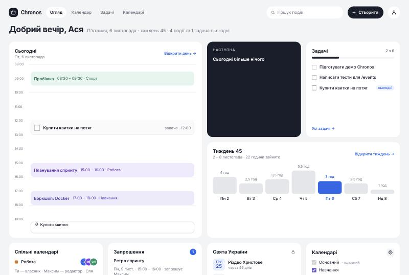
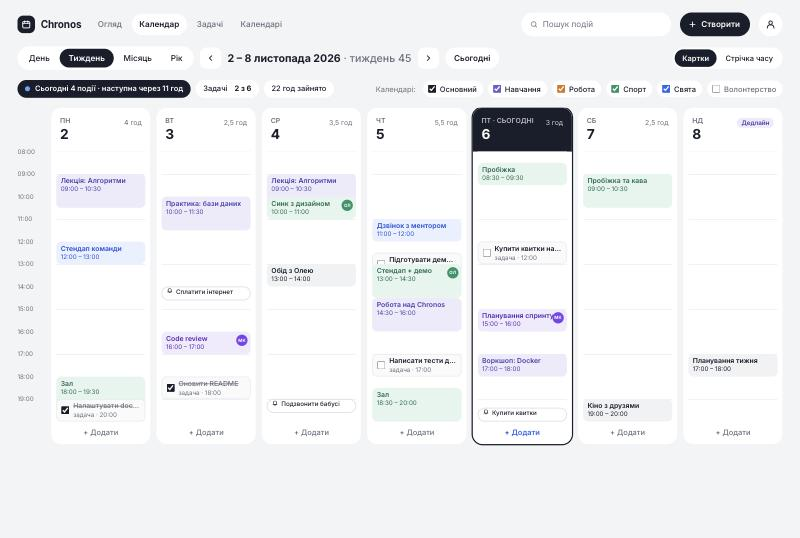
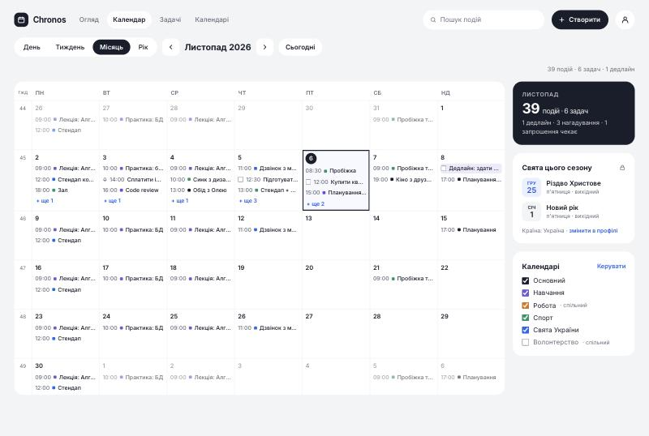
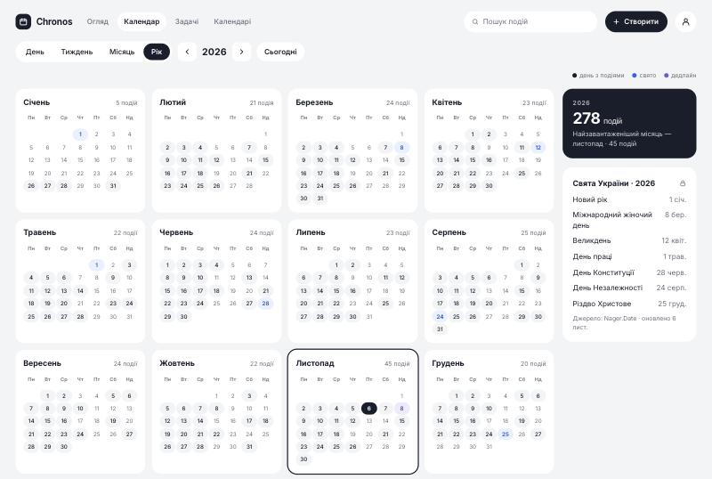
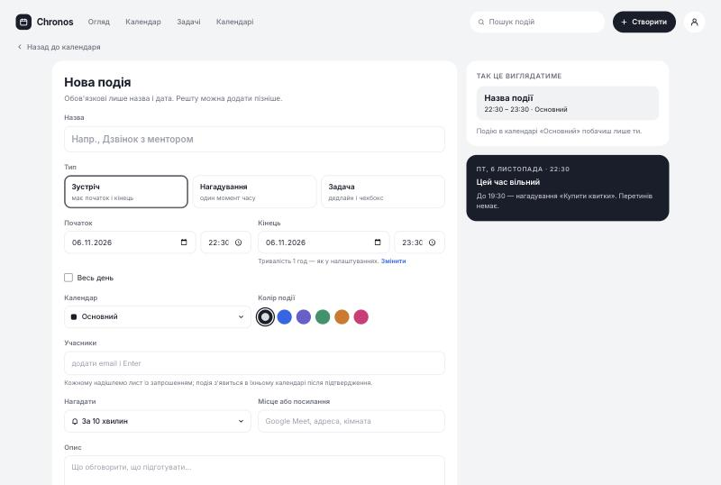
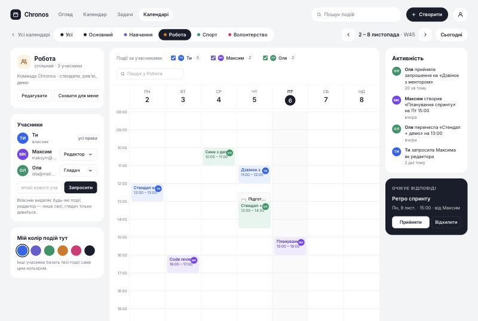
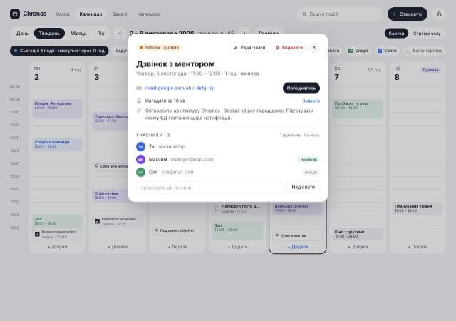
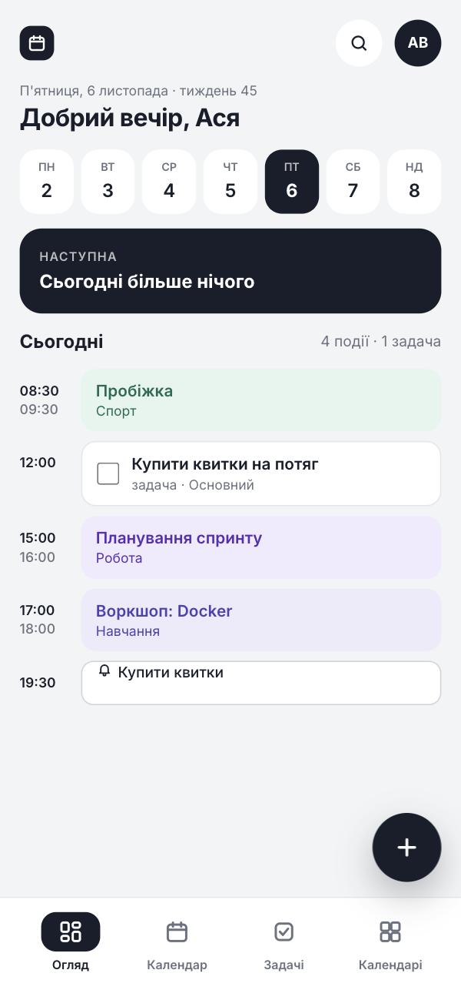

# Chronos

Веб-сервіс планування часу: зустрічі, нагадування й задачі в одному календарі, спільні календарі
з ролями, запрошення на email і державні свята твоєї країни. Проєкт виконується в межах
ucode connect, трек Full Stack (challenge «Chronos», Innovation Campus NTU «KhPI»).

> Стан: **фронтенд зверстано за всіма 16 мокапами** і працює на мок-даних; бекенд — каркас зі схемами моделей
> і маршрутами `501 Not Implemented`, бізнес-логіка пишеться командою по фічах (див. [docs/team.md](docs/team.md)).

## Стек

| Частина  | Технології                                                        |
|----------|-------------------------------------------------------------------|
| Backend  | Node.js 20, Express 4, MongoDB 7, Mongoose 8, JWT, Joi, nodemailer |
| Frontend | React 18, Vite 5, React Router 6, axios, CSS Modules               |
| Інфра    | Docker, Docker Compose, nginx (віддача фронту + проксі `/api`)    |
| Якість   | ESLint (Airbnb), Prettier, Jest + supertest                       |

Стайл-гайди: Google HTML/CSS, Airbnb React/JSX, Node.js Best Practices, Mongoose style guide, Docker Best Practices.

## Вимоги

- **Docker Desktop** (Docker Engine 24+ і Docker Compose v2.24+) — єдина вимога для запуску.
- Для розробки без Docker: **Node.js 20+**, **npm 10+**, локальна MongoDB 7 (або MongoDB Atlas).

## Запуск від клонування

```bash
git clone <url-репозиторію> chronos
```

```bash
cd chronos
```

```bash
cp .env.example .env
```

```bash
docker compose up --build
```

Після збірки:

- Фронт: <http://localhost:3000>
- API: <http://localhost:4000/api/health> → `{"status":"ok"}`
- MongoDB: `mongodb://localhost:27017/chronos`

Крок із `.env` необов'язковий: без нього compose підставляє dev-значення за замовчуванням.
Для реального розгортання задай власні `JWT_*_SECRET` і `SMTP_*` у `.env` (він у `.gitignore`).

### Dev-режим із hot reload

```bash
docker compose -f docker-compose.yml -f docker-compose.dev.yml up --build
```

Фронт на <http://localhost:5173> (Vite HMR, проксі `/api` на backend), backend під nodemon.
Вихідники монтуються з хоста, тож зміни підхоплюються без перезбірки.

### Локально без Docker

```bash
cp .env.example backend/.env
```

У `backend/.env` зміни `MONGO_URI` на `mongodb://localhost:27017/chronos`, потім у двох терміналах:

```bash
cd backend && npm install && npm run dev
```

```bash
cd frontend && npm install && npm run dev
```

Фронт <http://localhost:5173>, API <http://localhost:4000/api>.

### Корисні команди

| Команда                       | Де        | Що робить                                   |
|-------------------------------|-----------|---------------------------------------------|
| `npm run lint` / `lint:fix`   | обидва    | ESLint за Airbnb                            |
| `npm run format`              | обидва    | Prettier                                    |
| `npm test`                    | backend   | Jest + supertest (smoke-тест `/api/health`) |
| `npm run build`               | frontend  | Продакшн-збірка Vite у `dist/`              |

## Структура репозиторію

```
chronos/
├── backend/          Node + Express + Mongoose (ESM), feature-first модулі в src/modules
├── frontend/         React + Vite + React Router, компоненти в src/components, сторінки в src/pages
├── design/           Дизайн — джерело правди: README, tokens.css, 16 мокапів екранів
├── docs/             CBL-прогрес, API, модель даних, алгоритм, команда, ТЗ (PDF)
├── .github/          Шаблон PR, CODEOWNERS
├── docker-compose.yml       продакшн-подібний запуск
├── docker-compose.dev.yml   dev-режим із hot reload
└── .env.example
```

Детальніше: [CLAUDE.md](CLAUDE.md) (розділ «Структура репозиторію»), [docs/api.md](docs/api.md),
[docs/data-model.md](docs/data-model.md).

## Дизайн

Усі екрани, компоненти й поведінка описані в [design/README.md](design/README.md).
Кольори, шрифти, радіуси — тільки змінні з [design/tokens.css](design/tokens.css)
(підключено як `frontend/src/styles/tokens.css`). Мокапи відкриваються в браузері з `design/screens/`.

## Скріншоти

Зняті з фронту на мок-даних (`docs/screenshots/`). Повний набір мокапів — у `design/screens/`.

| Огляд | Календар · Тиждень |
|---|---|
|  |  |

| Календар · Місяць | Календар · Рік |
|---|---|
|  |  |

| Створення події | Спільний календар |
|---|---|
|  |  |

| Деталі події | Мобільна версія |
|---|---|
|  |  |

## Документація

- [docs/STATUS.md](docs/STATUS.md) — що вже зроблено і що лишилось, по частинах і власниках
- [docs/00-cbl-progress.md](docs/00-cbl-progress.md) — прогрес за етапами CBL (Engage / Investigate / Act / Document / Share)
- [docs/algorithm.md](docs/algorithm.md) — алгоритм роботи програми
- [docs/api.md](docs/api.md) — усі ендпоінти з тілами запитів і відповідей
- [docs/data-model.md](docs/data-model.md) — моделі та зв'язки
- [docs/team.md](docs/team.md) — розподіл, гілки, правила PR
- [docs/Chronos-TZ.pdf](docs/Chronos-TZ.pdf) — оригінальне ТЗ

## Команда

| Хто         | Зона відповідальності                                                        |
|-------------|------------------------------------------------------------------------------|
| @nastia     | Backend: auth, users, calendars, sharing/invites. Docker, README. Тех-лід     |
| @teammate1  | Backend: events, holidays, пошук і фільтри, nodemailer. Тести                 |
| @teammate2  | Frontend: усі подання календаря (день/тиждень/місяць/рік), модалки, форми    |
